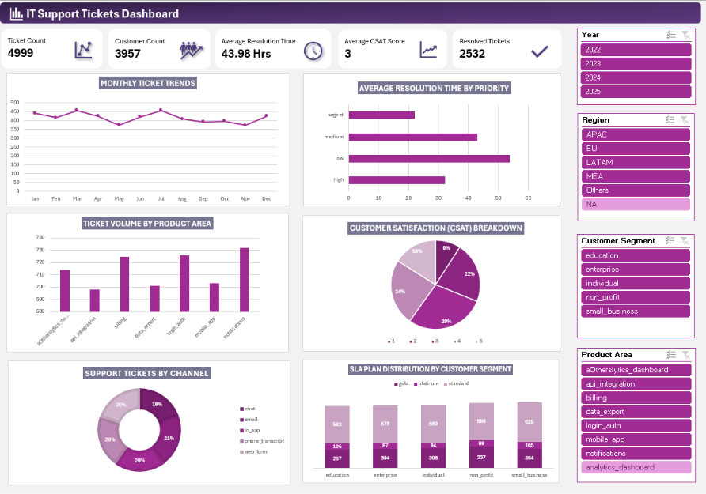

# IT Support Tickets Dashboard
Interactive Excel dashboard for analyzing IT support tickets, resolution time, SLA performance, and customer satisfaction to generate actionable business insights.

**🌟 Project Overview**

The IT Support Tickets Dashboard is an Excel-based data analytics project designed to analyze IT support operations, ticket resolution performance, customer satisfaction, and support trends across different product areas, channels, regions, and customer segments.

The dashboard transforms raw IT support ticket data into an interactive visual report that helps users monitor ticket volume, evaluate average resolution time by priority, understand customer satisfaction ratings, and explore support ticket distribution across various categories.

Interactive slicers allow users to filter the dashboard by Year, Region, Customer Segment, and Product Area, making it easier to explore specific segments and understand IT support performance.

**📊 Business Problem**

IT support teams handle a large number of customer issues across different products, platforms, and communication channels. Analyzing raw ticket data manually can make it difficult to monitor ticket status, identify common issues, evaluate resolution efficiency, and understand customer satisfaction.

Without a consolidated view of support operations, it can be challenging to identify trends, compare ticket priorities, and understand how support requirements vary across customer segments and regions.

This project addresses these challenges by presenting key performance indicators (KPIs) and interactive visualizations in a single Excel dashboard.

**🎯 Key Objectives**

Monitor overall IT support performance using key performance indicators (KPIs).

Analyze monthly ticket trends to understand changes in support demand.

Compare average ticket resolution time across different priority levels.

Identify product areas with higher ticket volumes.

Analyze customer satisfaction (CSAT) score distribution.

Understand ticket distribution across different support channels.

Compare ticket distribution across customer segments and SLA plans.

Enable interactive analysis using Excel slicers.

**📝 Tools and Technologies**

Microsoft Excel - Data preparation, KPI development, PivotTables, PivotCharts, slicers, and dashboard design.

Excel formulas - Calculation of ticket metrics, average resolution time, and customer satisfaction indicators.

PivotTables and PivotCharts - Aggregation and visualization of IT support ticket data.

Interactive slicers - Dynamic filtering by year, region, customer segment, and product area.

**🚀 Key Performance Indicators (KPIs)**

The dashboard includes five primary KPIs:

Ticket Count - Total number of support tickets.

Customer Count - Number of distinct customers represented in the dataset.

Average Resolution Time - Average time taken to resolve support tickets, measured in hours.

Average CSAT Score - Average customer satisfaction score.

Resolved Tickets - Number of tickets marked as resolved.

**📈 Dashboard Visualizations**

**✅ Conclusion**

The IT Support Tickets Dashboard converts raw support ticket data into meaningful operational insights through interactive KPIs, charts, and slicers. It helps users monitor support demand, compare resolution times across priority levels, identify product areas with higher ticket volumes, understand customer satisfaction, and explore ticket distribution across support channels and customer segments.

These insights can support data-driven decisions to improve support workflows, prioritize recurring issues, monitor service performance, and enhance the overall customer support experience.